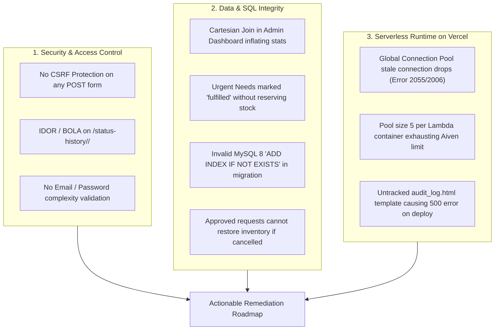

# Comprehensive Codebase & Architecture Review: ReMedi (`RahulRanjan67/remedi67`)

> **Review Target**: GitHub Repository `RahulRanjan67/remedi67` & Local Workspace (`C:\Users\67rah\Downloads\ReMedi\remedi`)  
> **Platform & Stack**: Python 3.13, Flask 3.x, Flask-Login, MySQL 8.0 (Aiven), Jinja2, Vercel Serverless  
> **Status**: Working prototype deployed on Vercel with extensive pending local architectural refactoring.

---

## Executive Summary

ReMedi is a multi-role medicine donation and redistribution platform connecting donors (sellers), recipients (buyers), NGOs, and community pharmacies with geofenced city partitioning.

A comprehensive audit of both the upstream GitHub repository (`origin/main`) and the active local working tree revealed significant achievements alongside several **critical security vulnerabilities**, **database logic flaws**, **Vercel serverless latency/connection bugs**, and **repository synchronization discrepancies** that should be resolved prior to further production use.



---

## 1. Repository & Git Synchronization Issues

### 1.1 Repository Name Discrepancy
- Upstream GitHub remote is configured as `https://github.com/RahulRanjan67/remedi67` (note the `67` suffix).
- Attempting to access `RahulRanjan67/remedi` returns `404 Not Found`. Any documentation or links referencing `RahulRanjan67/remedi` should be updated to `remedi67` or redirected.

### 1.2 Uncommitted Local Work & Merge Conflict Risk
- `origin/main` has 1 commit ahead: `fef01e0` (*"Update README.md"*).
- The local working directory has **42 modified files** and **3 untracked files**:
  - `templates/admin/audit_log.html`
  - `database/migrate.sql`
  - `update.md`
- > [!CAUTION]
  > `templates/admin/audit_log.html` is referenced in `routes/admin.py:37` (`render_template("admin/audit_log.html", logs=logs)`). If current code is deployed to Vercel without committing this template, navigating to `/admin/audit-log` will throw a fatal `jinja2.exceptions.TemplateNotFound: admin/audit_log.html` (HTTP 500).

### 1.3 README vs. Database Sample Data Inconsistency
- In [README.md](file:///C:/Users/67rah/Downloads/ReMedi/remedi/README.md#L50-L53), the sample credentials are documented as:
  ```text
  dev@remedi.in (developer), admin@remedi.in (admin), bhopal.seller1@remedi.in, bhopal.buyer1@remedi.in, ngo.seva@remedi.in
  ```
- In [database/sample.sql](file:///C:/Users/67rah/Downloads/ReMedi/remedi/database/sample.sql#L1-L15), the actual demo accounts use generic names:
  ```text
  dev@example.com, admin@example.com, ngo1@example.com, user1.city1@example.com
  ```
  And the cities are named `Demo City 1` through `Demo City 10`.
- Anyone following the README instructions cannot log into the seeded test accounts.

### 1.4 Missing Git Ignore Rules
- `.pytest_cache/` is untracked in `.gitignore` and leaves cache artifacts in the working tree.

---

## 2. Security & Authorization Vulnerabilities

### 2.1 Complete Absence of CSRF Protection
- **Vulnerability**: Critical.
- None of the state-changing `POST` routes across the application validate a CSRF token:
  - Account actions (`/auth/register`, `/auth/login`)
  - Admin governance (`/admin/approve-ngo/<uid>`)
  - NGO verifications and approvals (`/ngo/donations/<did>/verify`, `/ngo/requests/<rid>/approve`)
  - Medicine donations and requests (`/seller/donate`, `/buyer/request/<iid>`)
- **Impact**: Any malicious website can forge cross-origin POST requests on behalf of an authenticated admin or NGO user.
- **Remediation**: Integrate `Flask-WTF`'s `CSRFProtect(app)` and add `{{ csrf_token() }}` to all HTML forms.

### 2.2 Insecure Direct Object Reference (IDOR / BOLA) in Status History
- **Vulnerability**: High.
- In [routes/common.py](file:///C:/Users/67rah/Downloads/ReMedi/remedi/routes/common.py#L122-L128):
  ```python
  @bp.route("/status-history/<kind>/<int:eid>")
  @login_required
  def history(kind, eid):
      if kind not in ("donation", "request"):
          abort(404)
      rows = query("SELECT * FROM status_history WHERE entity_type=%s AND entity_id=%s ORDER BY changed_at DESC,history_id DESC", (kind, eid))
      return render_template("status_history.html", history=rows)
  ```
- **Flaw**: Any logged-in user (regardless of role or ownership) can view the complete status transition trail, user IDs, internal rejection notes, and timestamps of *any* donation or request in the database by simply guessing the integer ID.
- **Remediation**: Enforce ownership checks (`current_user.user_id` matches the buyer/seller, or `current_user.role in ('admin', 'developer', 'ngo')`).

### 2.3 Registration & Input Validation Hardening
- In [routes/auth.py](file:///C:/Users/67rah/Downloads/ReMedi/remedi/routes/auth.py#L30-L55):
  - **No email format validation**: Values like `"invalidemail"` are accepted and stored.
  - **No password minimum length or strength requirement**: Passwords of length 1 are accepted.
  - **Unbounded input lengths**: Fields accept arbitrary payload lengths without truncation or database string length guarding.
  - **No rate limiting**: No defense against brute-force login attempts on `/auth/login`.

### 2.4 Default Secret Key Risk Outside Vercel
- In [config.py](file:///C:/Users/67rah/Downloads/ReMedi/remedi/config.py#L22-L28):
  ```python
  SECRET_KEY = os.environ.get("SECRET_KEY", "dev-secret")
  ...
  if (onvercel and SECRET_KEY == "dev-secret"):
      raise RuntimeError("SECRET_KEY is not set in the Vercel project settings")
  ```
- If the project is deployed to Docker, Railway, Render, Fly.io, or any non-Vercel environment, `onvercel` evaluates to `False`. The server boots with `"dev-secret"`, allowing anyone to forge signed Flask session cookies and impersonate developers or administrators.

---

## 3. Database & Business Logic Flaws

### 3.1 Cartesian Product Aggregation Bug in Admin Dashboard
- In [routes/admin.py](file:///C:/Users/67rah/Downloads/ReMedi/remedi/routes/admin.py#L24):
  ```python
  cityrows = query("SELECT d.city, COUNT(DISTINCT d.donation_id) AS dons, SUM(d.status='verified') AS ver, SUM(d.status='rejected') AS rej, COUNT(DISTINCT i.inventory_id) AS invs FROM donations d LEFT JOIN inventory i ON i.city=d.city GROUP BY d.city ORDER BY d.city")
  ```
- **Flaw**: Joining `donations` and `inventory` solely on `i.city = d.city` produces an $N \times M$ Cartesian product for each city. While `dons` and `invs` use `COUNT(DISTINCT ...)`, the expressions `SUM(d.status='verified')` and `SUM(d.status='rejected')` do **not** deduplicate.
- **Result**: If a city has 5 verified donations and 4 inventory items, `ver` evaluates to $5 \times 4 = 20$ instead of 5!
- **Fix**:
  ```sql
  SELECT 
      d.city,
      COUNT(DISTINCT d.donation_id) AS dons,
      COUNT(DISTINCT CASE WHEN d.status = 'verified' THEN d.donation_id END) AS ver,
      COUNT(DISTINCT CASE WHEN d.status = 'rejected' THEN d.donation_id END) AS rej,
      COUNT(DISTINCT i.inventory_id) AS invs
  FROM donations d
  LEFT JOIN inventory i ON i.city = d.city
  GROUP BY d.city
  ORDER BY d.city
  ```

### 3.2 Silent False Fulfillment in Urgent Needs
- In [models/urgent.py](file:///C:/Users/67rah/Downloads/ReMedi/remedi/models/urgent.py#L16-L21):
  ```python
  def refresh(city=None):
      ...
      query("UPDATE urgent_needs SET status='fulfilled' WHERE status='open' AND (%s IS NULL OR city=%s) AND quantity_required<=(SELECT COALESCE(SUM(i.quantity_available),0) FROM inventory i WHERE i.medicine_id=urgent_needs.medicine_id AND i.city=urgent_needs.city AND i.quantity_available>0 AND i.expiry_date>=CURDATE())", (city, city), commit=True)
  ```
- **Flaw**: When matching inventory exists in the city, the system automatically sets `urgent_needs.status = 'fulfilled'`. However:
  1. No medicine is allocated or reserved for the user who posted the urgent need.
  2. No request record is created in `requests`.
  3. No notification is sent to the user.
  4. Another user can claim the entire stock.
- **Result**: The patient’s urgent need disappears from the public notice board as "fulfilled", while the patient receives nothing and remains unaware that medicine was ever available.
- **Fix**: Instead of silently setting `status='fulfilled'`, create an alert notification for the user: *"Good news: [Medicine] is currently in stock in [City]. Click here to request it."* Only mark the urgent need as fulfilled once an approved request is completed.

### 3.3 Missing Inventory Restoral on Cancelled or Rejected Requests
- In [models/req.py](file:///C:/Users/67rah/Downloads/ReMedi/remedi/models/req.py#L30-L75):
  - When a request is approved, `quantity_available` is deducted from `inventory`.
  - However, there is no workflow to handle cases where an approved medicine is damaged, unclaimed, or returned.
  - If an NGO marks an approved request as cancelled or rejected, the deducted quantity is permanently lost from available stock.

### 3.4 Invalid MySQL 8.0 Syntax in `database/migrate.sql`
- Lines 12 and 15 in [database/migrate.sql](file:///C:/Users/67rah/Downloads/ReMedi/remedi/database/migrate.sql#L12-L15) state:
  ```sql
  ALTER TABLE donations ADD INDEX IF NOT EXISTS idxseller (seller_id,status);
  ALTER TABLE status_history ADD INDEX IF NOT EXISTS idxtime (changed_at);
  ```
- **Flaw**: `ADD INDEX IF NOT EXISTS` is MariaDB syntax. In MySQL 8.0 (used by Aiven), executing this causes:
  `ERROR 1064 (42000): You have an error in your SQL syntax near 'IF NOT EXISTS...'`
- **Fix**: Standard MySQL requires creating the index directly without `IF NOT EXISTS` or catching duplicate key errors programmatically:
  ```sql
  ALTER TABLE donations ADD INDEX idxseller (seller_id, status);
  ALTER TABLE status_history ADD INDEX idxtime (changed_at);
  ```

### 3.5 Fragile SQL Splitting in `init_db.py`
- In [init_db.py](file:///C:/Users/67rah/Downloads/ReMedi/remedi/init_db.py#L5-L10):
  ```python
  def run(path, cur):
      text = open(path, encoding="utf-8").read()
      for stmt in text.split(";"):
          stmt = stmt.strip()
          if stmt:
              cur.execute(stmt)
  ```
- Splitting raw SQL files by `;` breaks if any comment, description string, or batch code contains a semicolon (e.g. `description = 'Take twice daily; before meals'`).

---

## 4. Vercel Serverless & Performance Bottlenecks

The README specifically highlights:
> *"One issue still remains: some pages are slower to load than I want, especially during the deployed experience. I have identified this as the next area I need to work on and improve."*

The root causes of Vercel latency and dropped connections are identified below:

### 4.1 Connection Pool Stale Connection Drops (Errors 2055 / 2006)
- In [db.py](file:///C:/Users/67rah/Downloads/ReMedi/remedi/db.py#L7-L26), connection pooling is initialized via `mysql.connector.pooling.MySQLConnectionPool`.
- On Vercel, serverless function containers are frozen between invocations. During a freeze of 60+ seconds, the remote Aiven MySQL server closes idle TCP connections.
- When the container wakes up, `_getpool().get_connection()` returns a dead socket. Calling `cur.execute(...)` subsequently fails with:
  `mysql.connector.errors.OperationalError: 2055: Lost connection to MySQL server at '...'` or `2006: MySQL server has gone away`.
- **Fix**: Add a connection health verification and auto-reconnect in [db.py](file:///C:/Users/67rah/Downloads/ReMedi/remedi/db.py):
  ```python
  def opendb():
      try:
          conn = _getpool().get_connection()
          if not conn.is_connected():
              conn.reconnect(attempts=2, delay=1)
          return conn
      except mysql.connector.Error as err:
          # Fallback to direct connection if pool connection is stale
          return connect(usedb=True)
  ```

### 4.2 Pool Sizing on Serverless Lambda Instances
- In [db.py](file:///C:/Users/67rah/Downloads/ReMedi/remedi/db.py#L10), `pool_size` is fixed to 5.
- Because a Vercel serverless function container only handles **1 HTTP request at a time**, maintaining 5 pooled connections inside a single container wastes remote database sockets.
- If 6 concurrent requests arrive, Vercel spins up 6 containers, creating $6 \times 5 = 30$ open connections and quickly hitting Aiven's max connection ceiling.
- **Fix**: Dynamically set `pool_size = 1` or `2` when `config.onvercel` is True.

### 4.3 Redundant Queries on Every Request
- On every page load for an authenticated user:
  1. `loaduser(uid)` in [app.py](file:///C:/Users/67rah/Downloads/ReMedi/remedi/app.py#L14-L17) queries `users` table: `SELECT * FROM users WHERE user_id = %s`.
  2. Context processor calls `ctx()`: checks `notif.unread(uid)` (cached 30s) and calls `getcity()`.
  3. The route handler then executes 2 to 5 additional queries.
- Each query performs a full roundtrip over TLS to the cloud database (typically 60–120ms roundtrip latency from Vercel edge to Aiven region). Multiplying this across 4–6 serial queries produces an unavoidable 300–600ms page render delay.
- **Fix**: Combine dashboard aggregations into single CTE queries or batch queries to minimize serial network roundtrips.

---

## 5. Testability & Code Architecture

### 5.1 Unit Tests Tightly Coupled to Framework Dependencies
- In [tests/test_logic.py](file:///C:/Users/67rah/Downloads/ReMedi/remedi/tests/test_logic.py), the suite imports:
  ```python
  from util import fixcity, daysleft, expclass, tier, toint
  ```
- However, [util.py](file:///C:/Users/67rah/Downloads/ReMedi/remedi/util.py) unconditionally imports `flask`, `flask_login`, `db`, and `config` at module level:
  ```python
  from flask import abort, request, session
  from flask_login import current_user
  from db import query, logsql
  ```
- **Consequence**: Running `test_logic.py` without Flask and MySQL packages installed throws `ModuleNotFoundError: No module named 'flask'`. Pure mathematical and date logic functions should be decoupled into a standalone helper or Flask imports should be delayed.

### 5.2 Minimal Test Coverage
- There are only 8 unit tests in `test_logic.py`, limited to string and date calculations.
- There are zero unit or integration tests for:
  - Role-based route access (`needrole`)
  - Inventory quantity deductions and race conditions
  - Donation verification and NGO workflows
  - User registration and authentication flows

---

## 6. Actionable Remediation Roadmap

| Priority | Issue | Location | Recommended Action | Status |
| :--- | :--- | :--- | :--- | :--- |
| **P0** | Untracked template | `templates/admin/audit_log.html` | Stage and commit to git to prevent 500 error on deploy. | Pending Commit |
| **P0** | Invalid MySQL syntax | `database/migrate.sql` | Remove `IF NOT EXISTS` from `ADD INDEX` statements. | **Fixed Locally** |
| **P1** | CSRF Vulnerability | All POST forms & routes | Install `Flask-WTF`, enable `CSRFProtect(app)`, and embed CSRF tokens. | Planned |
| **P1** | IDOR / BOLA | `routes/common.py:history` | Add authorization check verifying current user ownership or administrative role. | **Fixed Locally** |
| **P1** | Cartesian Join Bug | `routes/admin.py:dash` | Update `cityrows` query to use `COUNT(DISTINCT CASE ...)` for verified and rejected sums. | **Fixed Locally** |
| **P1** | Serverless Stale DB Pool | `db.py:opendb` | Add `conn.is_connected()` check with reconnect fallback; reduce serverless pool size to 2. | **Fixed Locally** |
| **P2** | Urgent Needs Logic | `models/urgent.py:refresh` | Send user notification instead of silently marking urgent need as fulfilled. | **Fixed Locally** |
| **P2** | Inventory Leak on Rejection | `models/req.py:reject` | Restore deducted stock back to inventory when approved/ready request is rejected. | **Fixed Locally** |
| **P2** | Orphaned Pending Requests | `models/don.py:reject` | Auto-cancel pending buyer requests when a donation batch fails verification. | **Fixed Locally** |
| **P2** | Unassigned Stock Visibility | `models/req.py:byngo` | Allow NGOs to view and adopt requests on direct seller inventory in their city. | **Fixed Locally** |
| **P2** | README Demo Credentials | `README.md` | Align documented demo accounts with `sample.sql` (`dev@example.com`, etc.). | **Fixed Locally** |
| **P2** | Registration Hardening | `routes/auth.py:register` | Add email regex format validation and minimum password length checks. | **Fixed Locally** |
| **P3** | Test Suite Decoupling | `util.py` / `tests/` | Decouple pure helper functions from Flask dependencies; expanded unit tests. | **Fixed Locally** |
| **P3** | CI Pipeline | `.github/workflows/ci.yml` | Add GitHub Actions workflow to run pytest and linting automatically on pull requests. | Planned |

---

## 7. Recommended Feature Enhancements

1. **Patient Prescription Upload & Verification**:
   - For Schedule H / prescription medicines (antibiotics, insulin, psychiatric drugs), allow buyers to upload an image of a physician's prescription during request submission, letting NGOs verify medical authorization prior to approval.
2. **Secure Handover Code (OTP / Pickup Code)**:
   - When marking an approved medicine as "Ready for Pickup", generate a 4-digit pickup code or QR code sent to the patient. The pharmacy or NGO enters this code to confirm physical medicine handover before marking as "Completed", eliminating handover disputes.
3. **Automated Expiry Batch Quarantining**:
   - Schedule a lightweight daily cron/worker to mark inventory items with `expiry_date < CURDATE()` as quarantined/expired so expired batches are systematically removed from active distribution.
4. **Server-Side Pagination for Large Cities**:
   - Implement `LIMIT 20 OFFSET ?` for high-volume medicine search results and status history logs to keep database response times under 50ms.
5. **Rate Limiting on Authentication Endpoints**:
   - Add IP and user-based throttling (`Flask-Limiter`) to `/auth/login` to thwart credential stuffing and brute-force attacks.

---

## 8. QR Code Integration & Verification Architecture

To streamline physical medicine handovers and package intake, four QR code integration points have been implemented:

1. **Digital Medicine Pickup Pass (`/pass/request/<rid>`)**:
   - For approved and ready requests, recipients can generate a printable or mobile pass.
   - Embeds a crisp SVG QR code linking to `/pass/request/<rid>`.
   - Pharmacists and NGO officers can scan the code to instantly verify patient identity and authorized medicine/dosage.

2. **Donation Package Label (`/label/donation/<did>`)**:
   - Donors can print a physical package label to tape onto medicine boxes or blister packs.
   - Contains donation ID, batch number, medicine formulation, expiry date, and a scannable QR code.
   - NGO intake volunteers scan the QR to pre-populate inspection workflows in seconds.

3. **Pharmacy GPS Direction QR (`/qr/pharmacy/<pid>`)**:
   - Each registered pharmacy card generates a QR code encoding turn-by-turn navigation on Google Maps.
   - Desktop/tablet users can scan the code with their smartphone camera for instant mobile navigation to the dispensary.

4. **Batch Authenticity QR (`/qr/inventory/<iid>`)**:
   - Links directly to the immutable audit trail on `/status-history/donation/<did>`.

---

## 9. Implemented Architectural Enhancements

All user-accepted feature enhancements have been implemented following the author's compact coding style:

1. **Urgent Needs Matching & Direct Pre-Allocation**:
   - Integrated `urgent.match_donation(did, mid, city, qty, donor_name, urgent_id)` in `models/urgent.py` and `routes/seller.py`.
   - The medicine donation interface (`templates/seller/donate.html`) dynamically displays active urgent shortages in the donor's city.
   - Donors can click "Fulfill Need" to pre-fill the medicine name and requested quantity.
   - When submitted, matching patients are alerted immediately via notifications, bridging supply gaps in real time.

2. **Direct Pharmacist Login Role & Dispensary Dashboard**:
   - Added `'pharmacy'` role to `users.role` ENUM and linked `pharmacies.user_id` foreign key.
   - Created dedicated `routes/pharmacy.py` with `/pharmacy/dashboard`, `/pharmacy/ready/<rid>`, `/pharmacy/dispense/<rid>`, and `/pharmacy/verify-pass`.
   - Partner pharmacists can log in directly, view assigned requests, review Digital Pickup Passes, and confirm medication handovers.
   - Integrated dispensary navigation links into `templates/base.html` and routing in `common.dash()`.
   - Seeded 10 demo pharmacist accounts (`pharm1@example.com` .. `pharm10@example.com`) across 10 cities.

3. **Automated Expiry Quarantining Cron**:
   - Implemented `inv.quarantine_expired()` in `models/inv.py` to zero out stock for expired inventory, log transitions to `status_history`, and cancel pending requests with patient notifications.
   - Added public cron route `/cron/quarantine` (returning JSON status) for external schedulers / Vercel Cron.
   - Added Developer Diagnostic Console action (`/admin/developer/quarantine-expired`) for on-demand quarantine sweeps.
   - Added automated periodic background check in `app.before_request` with an in-memory 1-hour cooldown.
